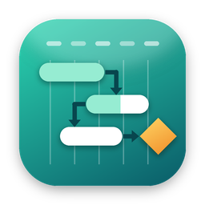

# PlanHawk

A free project planner for Windows from **Bytehawk Studio**, part of the Hawk suite. It does the same job as Microsoft Project: a task list with outline levels, a Gantt chart, dependencies between tasks and a critical path. It uses Bytehawk's Hawkline look (the same left sidebar as Guardrail EHS, WillowWallet and NoteHawk).

> **Preview (0.1.0):** this is the shell. Three sample projects are scheduled from their dependencies, and you can browse them on every screen. Adding and editing tasks, saving, opening `.mpp` files and the rest are marked **coming soon**.

## What works in the preview

- **Gantt chart:** task sheet (ID, indicators, name, duration, start, finish, predecessors) next to the timeline. Summary bars, milestones, progress, resource names, dependency arrows, weekends and a today line. Collapse and expand summary tasks, zoom between days, weeks and months, show the critical path, and select a task to see its schedule, predecessors and successors. Arrow keys move between tasks.
- **Tasks:** every task from every project with progress and status, filtered by project and status. Click one to open it on the Gantt chart.
- **Dependencies:** a network diagram of each project. Select a task to highlight what it waits for and what waits on it; the side panel lists every link (finish-to-start, start-to-start and lag).
- **Home:** project cards with mini Gantt charts, upcoming milestones, work due in the next 7 days, tasks that are behind and a timeline of all projects.
- Light and dark mode, and the scheduler behind it all: Monday to Friday calendar, finish-to-start and start-to-start links with lag, summary tasks and total slack.

## Planned

- Add, edit, indent and link tasks right in the sheet and on the chart (drag bars to move them)
- Save and open PlanHawk projects; open and save Microsoft Project files (`.mpp`, `.xml`) and Excel/CSV
- Finish-to-finish and start-to-finish links, constraints, deadlines and manual scheduling
- Resources, assignments, costs, leveling and the Team Planner
- Working calendars with holidays, baselines and variance
- Timeline, Board and Calendar views, reports and dashboards
- Templates
- PlanHawk Server (self-hosted) for sharing projects with a team

## Run it

- **Installer:** `PlanHawk-<version>-Setup.exe` from Releases (or through the Bytehawk Studio Launcher).
- **From source:** install the [.NET 8 SDK](https://dotnet.microsoft.com/download/dotnet/8.0), then double-click `run.bat`.
- **Build the exe, zip and installer:** `.\build.ps1` (needs Inno Setup 6: `winget install JRSoftware.InnoSetup`).

## Project layout

| Path | What |
|---|---|
| `src/PlanHawk.Desktop` | WPF (.NET 8) app |
| `src/PlanHawk.Desktop/Models/ProjectData.cs` | tasks, links, the scheduler (dates, critical path, progress) and the sample projects |
| `src/PlanHawk.Desktop/Models/ModuleCatalog.cs` | every sidebar section and its planned features |
| `src/PlanHawk.Desktop/Views/GanttView.cs` | the Gantt chart |
| `src/PlanHawk.Desktop/Views/NetworkView.cs` | the Dependencies network diagram |
| `tools/make_icon.py` | draws the app icon |
| `tools/make_icon_font.py` | builds the icon font from Fluent UI System Icons (MIT) |
| `installer/PlanHawk.iss` | Inno Setup installer |

Releasing: bump `<Version>` in the .csproj and push to `main`; CI builds, self-tests, test-installs and publishes the GitHub Release.

© 2026 Bytehawk Studio. MIT License.
